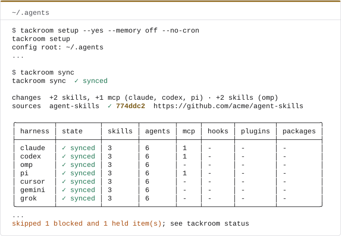

# tackroom

tackroom syncs one `~/.agents` repo into 15 coding agents and pins every outside skill to a commit.

<picture>
  <source media="(prefers-color-scheme: dark)" srcset="docs/images/tackroom-dark.svg">
  
</picture>

[Website](https://yourconscience.github.io/tackroom/) · [Docs](https://yourconscience.github.io/tackroom/docs/) · [Releases](https://github.com/yourconscience/tackroom/releases)

## Install

```bash
brew install yourconscience/tap/tackroom
npm install -g tackroom
```

Pick one. Both install the same checksum-verified binary for macOS or Linux, arm64 or x86-64.

## Set up

```bash
tackroom setup
```

`setup` creates `~/.agents`, finds the agents you have, copies in their skills, MCP servers and roles after you review each item, and runs the first sync. Originals stay where they are. After that, you work in the view; the commands do the same from a shell or a script:

```bash
tackroom view     # the dashboard: sync state, pins, holds, crons; desktop or phone
tackroom sync     # write each agent's native config from the repo
tackroom status   # what is synced, held or blocked
tackroom doctor   # check skills, roles, pins, audits and hooks
tackroom hosts    # every machine in crons.hosts: version, sync state, config commit
```

## What it syncs

- **Skills**: one folder with a `SKILL.md` per skill ([agentskills.io](https://agentskills.io)), made available to every agent.
- **MCP servers**: written into each agent's own config file.
- **Hooks**: one definition, rendered with each agent's event names.
- **Agent roles**: Markdown roles rendered as Claude Markdown, Codex TOML, Copilot `.agent.md` and the rest.
- **Plugins**: Claude Code plugins load in place from the repo; [agent-plugins-spec](https://agent-plugins.org) sources add their skills and MCP servers, and Codex installs them as native plugins.

Root instructions come along too: `~/.agents/AGENTS.md` becomes `CLAUDE.md`, `GEMINI.md` and the others.

## Outside skills are dependencies

- **Pin**: each external skill source is locked to a commit in `tackroom.lock`. Only `tackroom skill update` moves it.
- **Audit**: outside content is scanned. An unaccepted CRITICAL finding stops it from syncing and the previous pin stays.
- **Hold**: a new pin, or a new exact npm or PyPI version, waits until it is 72 hours old. `tackroom sync --allow-fresh` releases it.

## Agents

Claude Code, Codex, Factory Droid, OMP, OpenCode, Pi, Qwen Code, Cursor, Gemini CLI, GitHub Copilot CLI, Grok Build, DeepSeek Harness, Antigravity CLI, Kimi Code and Amp. What each one gets is in the [capability matrix](https://yourconscience.github.io/tackroom/docs/harnesses/).

Terminals: a panel for [Herdr](https://yourconscience.github.io/tackroom/docs/herdr/), a crons panel and a `tackroom tern` workspace for [Tern](https://yourconscience.github.io/tackroom/docs/tern/), and a `tackroom rex` workspace and palette actions for [Rex](https://yourconscience.github.io/tackroom/docs/rex/).

## Docs

- [Setup](https://yourconscience.github.io/tackroom/docs/setup/): first run, the review screen, more machines, settings
- [Harnesses](https://yourconscience.github.io/tackroom/docs/harnesses/): the capability matrix
- [Commands](https://yourconscience.github.io/tackroom/docs/commands/): every command and flag
- [MCP servers](https://yourconscience.github.io/tackroom/docs/mcp/) and [hooks](https://yourconscience.github.io/tackroom/docs/hooks/)
- [Web view](https://yourconscience.github.io/tackroom/docs/view/): the dashboard, on a desktop or a phone
- [Skills](https://yourconscience.github.io/tackroom/docs/skills/): writing skills, external sources, pins, audits and holds
- [Roles](https://yourconscience.github.io/tackroom/docs/roles/): role format, model tiers, per-agent output
- [Memory](https://yourconscience.github.io/tackroom/docs/memory/): memory tiers and the `rem` workflow
- [Crons](https://yourconscience.github.io/tackroom/docs/crons/): every scheduled job, here and over SSH
- [Comparison](https://yourconscience.github.io/tackroom/docs/comparison/) and [moving from skillshare](https://yourconscience.github.io/tackroom/docs/skillshare-migration/)
- [Philosophy](https://yourconscience.github.io/tackroom/docs/philosophy/): why it works this way
- [Upgrading](https://yourconscience.github.io/tackroom/docs/upgrading/) and [Troubleshooting](https://yourconscience.github.io/tackroom/docs/troubleshooting/)

Contributions: see [CONTRIBUTING.md](CONTRIBUTING.md).

## License

[MIT](LICENSE)
