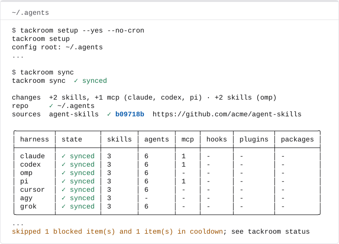

# tackroom

One repo for everything your coding agents read, including the parts that never port: MCP servers, hooks and subagents. 16 harnesses, each in its own format.

<picture>
  <source media="(prefers-color-scheme: dark)" srcset="docs/images/tackroom-dark.svg">
  
</picture>

[Website](https://yourconscience.github.io/tackroom/) · [Docs](https://yourconscience.github.io/tackroom/docs/) · [Releases](https://github.com/yourconscience/tackroom/releases)

## Install and set up

```bash
brew install yourconscience/tap/tackroom && tackroom setup
```

With npm: `npm install -g tackroom && tackroom setup`. Both install the same checksum-verified binary for macOS or Linux, arm64 or x86-64.

`setup` asks nothing. It creates `~/.agents`, finds the agents you have, copies in their skills, MCP servers and roles, runs the first sync and prints a short summary. A native file that differs from the shared copy is backed up before it is replaced. `tackroom setup --review` asks before each step instead. On another machine, run `tackroom setup --from <your config repo url>`.

After that, you work in the view; the commands do the same from a shell or a script:

```bash
tackroom view     # the dashboard: sync state, pins, cooldowns, crons; desktop or phone
tackroom sync     # write each agent's native config from the repo
tackroom status   # what is synced, in cooldown or blocked
tackroom doctor   # check skills, roles, pins, audits and hooks
tackroom hosts    # every machine in crons.hosts: version, sync state, config commit
```

## What it syncs

- **Skills**: one folder with a `SKILL.md` per skill ([agentskills.io](https://agentskills.io)), made available to every agent.
- **MCP servers**: written into each agent's own config file.
- **Hooks**: one definition, rendered with each agent's event names.
- **Agent roles**: Markdown roles rendered as Claude Markdown, Codex TOML, Copilot `.agent.md` and the rest.
- **Plugins**: Claude Code plugins load in place from the repo; [agent-plugins-spec](https://agent-plugins.org) sources add their skills and MCP servers, and Codex installs them as native plugins.

Root instructions come along too: `~/.agents/AGENTS.md` becomes `CLAUDE.md`, `GEMINI.md` and the others.

## Outside skills are dependencies

- **Pin**: each external skill source is locked to a commit in `tackroom.lock`. Only `tackroom skill update` moves it.
- **Audit**: outside content is scanned. An unaccepted CRITICAL finding stops it from syncing and the previous pin stays.
- **Cooldown**: a new pin, or a new exact npm or PyPI version, waits until it is 72 hours old, unless a published advisory names that version as a security fix. `tackroom sync --allow-fresh` skips the cooldown.

## Agents

Claude Code, Codex, Factory Droid, OMP, OpenCode, Pi, Qwen Code, Cursor, Devin, Gemini CLI, GitHub Copilot CLI, Grok Build, DeepSeek Harness, Antigravity CLI, Kimi Code and Amp. What each one gets is in the [capability matrix](https://yourconscience.github.io/tackroom/docs/harnesses/).

Terminals: [`tackroom dash`](https://yourconscience.github.io/tackroom/docs/terminals/#dash), a live screen for a terminal pane with the sync state and the scheduled jobs, which the workspaces and the Rex panel below open; a `tackroom tmux` workspace for [tmux](https://yourconscience.github.io/tackroom/docs/terminals/#tmux), a `tackroom zellij` workspace for [zellij](https://yourconscience.github.io/tackroom/docs/terminals/#zellij), a panel for [Herdr](https://yourconscience.github.io/tackroom/docs/terminals/#herdr-panel) (one line to your agent from Herdr's mod gallery), a crons panel and a `tackroom tern` workspace for [Tern](https://yourconscience.github.io/tackroom/docs/terminals/#tern), and a `tackroom rex` panel with a palette action for [Rex](https://yourconscience.github.io/tackroom/docs/terminals/#rex). A recipe for [cmux](https://yourconscience.github.io/tackroom/docs/terminals/#cmux) is on the same page.

## Docs

- [Philosophy](https://yourconscience.github.io/tackroom/docs/philosophy/): why it works this way
- [Setup](https://yourconscience.github.io/tackroom/docs/setup/): first run, `--review`, more machines with `--from` and `--overlay`, settings, upgrade and uninstall
- [Commands](https://yourconscience.github.io/tackroom/docs/commands/): every command and flag
- [Harnesses](https://yourconscience.github.io/tackroom/docs/harnesses/): the capability matrix
- [Skills](https://yourconscience.github.io/tackroom/docs/skills/): writing skills, external sources, pins, audits and cooldowns
- [Roles](https://yourconscience.github.io/tackroom/docs/roles/): role format, model tiers, per-agent output
- [MCP servers](https://yourconscience.github.io/tackroom/docs/mcp/) and [hooks](https://yourconscience.github.io/tackroom/docs/hooks/)
- [Plugins](https://yourconscience.github.io/tackroom/docs/plugins/): Claude Code plugins, agent-plugins-spec sources and the Claude Code and Pi panels
- [Memory](https://yourconscience.github.io/tackroom/docs/memory/): a memory file in every harness, and native memory settings
- [Crons](https://yourconscience.github.io/tackroom/docs/crons/): every scheduled job, here and over SSH
- [Web view](https://yourconscience.github.io/tackroom/docs/view/): the dashboard, on a desktop or a phone
- [Terminals](https://yourconscience.github.io/tackroom/docs/terminals/): tmux, zellij, Herdr, Tern, Rex and cmux
- [Comparison](https://yourconscience.github.io/tackroom/docs/comparison/), with [moving from skillshare](https://yourconscience.github.io/tackroom/docs/comparison/#moving-from-skillshare)
- [Troubleshooting](https://yourconscience.github.io/tackroom/docs/troubleshooting/) and the [release notes](https://yourconscience.github.io/tackroom/docs/upgrading/)

Contributions: see [CONTRIBUTING.md](CONTRIBUTING.md).

## License

[MIT](LICENSE)
