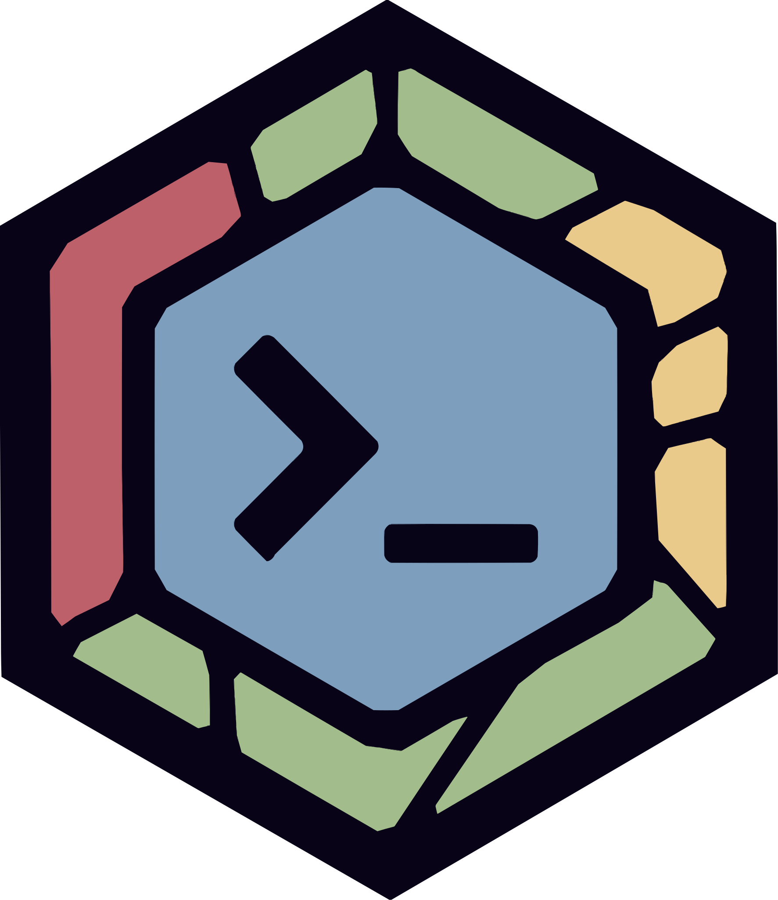
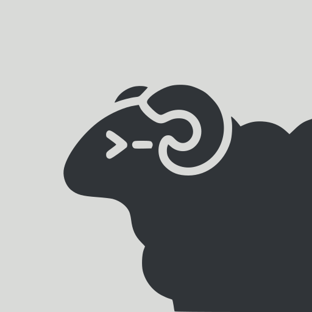

# Terminals

tackroom has integrations for tmux, zellij, Herdr, Tern and Rex, and a recipe for cmux. Each integration is optional and calls the same `tackroom` commands you can run in any shell. There are three kinds of integration:

- A panel is tackroom's own interface inside the terminal.
- A workspace command opens a session in the terminal with a shell and [`tackroom dash`](#dash).
- A recipe is a snippet you add or run yourself.

| Tool | Panel | Workspace command | Recipe |
| --- | --- | --- | --- |
|  [tmux](#tmux) | - | `tackroom tmux` | [popup](#popup) with `tackroom status` |
|  [zellij](#zellij) | - | `tackroom zellij` | - |
|  [Herdr](#herdr) | [tackroom panel](#herdr-panel) in the Herdr app; the Herdr TUI has none | - | - |
|  [Tern](#tern) | crons panel | `tackroom tern` | - |
|  [Rex](#rex) | - | `tackroom rex` | palette actions |
| [cmux](#cmux) | - | - | `cmux new-workspace`, not run here |

## Dash

`tackroom dash` is a live screen for a terminal pane, and the four workspace commands open it next to a shell: above it in tmux, zellij and Rex, below it in Tern. It answers two questions at a glance: is everything in sync, and which scheduled jobs fail.

```bash
tackroom dash [--config PATH]
```

From the top:

- A header with the overall state as `tackroom status` decides it (`synced` or `needs attention`), the number of detected harnesses and of pinned skill sources, and the time of the last refresh, or `refreshing…` while one runs.
- A crons line with the number of jobs, how many are failing and how many failed their last run, and any host in `crons.hosts` that could not be reached. These come from the job health the web view uses: a job with problems is failing, a job whose last exit or last status says it failed has a last run that failed, and a paused job is neither, whatever its last exit. Then one row per job: host, id, state, last run (`2m ago`, `3h ago`, `8d ago`) and result (`exit N` or the last status, or `problem` for a job with problems and no failed exit), red for a failing job, yellow for a last run that failed and dim for a paused job. Failing jobs come first, then the ones whose last run failed, then the rest in the order `cron collect` finds them. The list scrolls and says how many more jobs are above or below.
- Under the list, the selected job's schedule, source and problems.
- The harnesses: one that drifted or failed comes first, on a line of its own with what is wrong, then every other one with `✓`, and those not detected last. Then how many items are in cooldown or blocked, and the lock check when it did not pass.
- A message line with a question, the result of the last action or sync, or else the error of a refresh, and the keys.

Rows are cut, never wrapped, and a resized pane is drawn again at once. In a narrow pane the jobs lose the state column, then the last run, and a long id is shortened in the middle. From 8 lines up (fewer with three jobs or less) the header, the crons line, three job rows, the message line and the keys always fit; a shorter pane first shows the harnesses as one line, such as `12 harnesses: 11 synced, 1 drifted (qwen-code)`, then scrolls the list, then drops the detail lines. Below 8 lines the harness block and the detail go, the message line takes the place of the keys whenever it has something to say, and the list shrinks down to the selected job; at 3 lines the crons line goes too, at 2 lines the header. From 2 lines up, a question waiting for y or n and the selected job are always on screen.

| Key | Action |
| --- | --- |
| `↑` `↓`, `k` `j` | Select a job; `g` and `G`, or Home and End, go to the first and the last |
| Enter | Run the selected job now; for a paused job (disabled or not loaded), only `p` |
| `p` | Pause the selected job, or resume it when it is disabled or not loaded |
| `r` | Refresh everything now |
| `s` | Sync as `tackroom sync` does, then show what changed |
| `q` | Quit; while an action or a sync runs, it waits, so a sync is not cut off mid-write |
| Ctrl-C | Quit at once |

Enter, `p` and `s` ask first in the message line, for example `run ai.knowledge-sync on m1 now? y/n`; any key other than `y` cancels. At `y` the job must still be in the last scan, or nothing runs and the message line says to press `r`. Run now, Pause and Resume work on launchd jobs, on this machine or on a host in `crons.hosts`, and run the same `launchctl` commands as the web view ([crons.md](crons.md#run-pause-and-resume-jobs)), which offers the same ones: Resume alone for a paused job. For any other job, Enter and `p` say they work on launchd jobs only, without asking. A launchd service, a job that runs on load or stays alive rather than on a schedule, is not paused here: the scan leaves a disabled service out, so nothing would be left to resume.

The dash refreshes while it runs: the sync state every 30 seconds, which reads only this machine, and the crons every 5 minutes, after Run now, Pause or Resume (the job's host), and on `r`. A crons collect probes every host over SSH and can take a while; the screen stays usable meanwhile. A refresh that fails leaves the last data on screen, marked: the header says the status is unknown and the harnesses say when they are from, or the crons line says stale. Its error shows in the message line when no question or result is there, and goes when that refresh next succeeds. Warnings and git output from the collectors and sync are kept off the screen; `tackroom status` and `tackroom sync` print them. A sync from the dash never asks anything on the terminal: git runs with `GIT_TERMINAL_PROMPT=0` and, unless you set `GIT_SSH_COMMAND`, `GIT_SSH` or git's `core.sshCommand` yourself, with ssh in batch mode, so a clone that needs a password or an unknown host key fails and the message line shows the error.

It needs a terminal on stdout; otherwise it prints `tackroom dash needs a terminal; use tackroom status and tackroom cron collect --table` and exits 1. It follows `NO_COLOR`.

## tmux

 [tmux](https://github.com/tmux/tmux) is the terminal multiplexer. `tackroom tmux` opens a tackroom workspace in it.

```bash
tackroom tmux [--config PATH] [--dry-run]
```

It creates a session named `tackroom` in the config root with two panes: [`tackroom dash`](#dash) across the full width on top, with 70% of the height, and a shell below it, which has the focus. Then it shows the session. Outside tmux it attaches to it; inside tmux it switches your client to it; with no terminal on stdin or stdout it prints the `tmux attach-session` command instead.

The dash pane runs the same `tackroom` that opened it, by its absolute path, and keeps a shell open when the dash ends, so an error stays readable.

A second run shows the existing `tackroom` session instead of creating another. `--dry-run` prints the `tmux` commands and runs nothing. `--config PATH` takes a config file, as every other command does, and opens the session in its folder. Without it the root follows `$TACKROOM_HOME`, else `~/.agents`. An absent `tmux` is an error.

Checked with tmux 3.7c on macOS; not checked on Linux.

### Popup

To see `tackroom status` over what you are working on, bind a key in `~/.tmux.conf`:

```
bind-key T display-popup -w 90% -h 80% 'tackroom status'
```

Press the prefix key, then `T`. The popup stays open after the command ends and Escape closes it. Adding `-E` would close it as soon as the command ends, before you can read it. `tackroom` must be on the `PATH` of the tmux server. Checked with tmux 3.7c.

## zellij

 [zellij](https://github.com/zellij-org/zellij) is a terminal workspace with layouts written in KDL. `tackroom zellij` opens a tackroom workspace in it.

```bash
tackroom zellij [--config PATH] [--dry-run]
```

It writes this layout to a temporary file, never into zellij's own config folder, with the config root and the path of the running `tackroom` filled in:

```kdl
layout {
    cwd "/home/you/.agents"
    pane split_direction="horizontal" {
        pane name="dash" size="70%" command="/usr/local/bin/tackroom" { args "dash"; }
        pane name="shell" focus=true
    }
}
```

Run inside zellij, it adds the workspace to the session you are in as a tab named `tackroom`, and each run adds another tab. Run outside zellij, it attaches to the session named `tackroom` if there is one, and otherwise starts that session with the layout.

zellij needs a terminal to create or attach to a session, so with no terminal on stdin or stdout `tackroom zellij` prints the `zellij` command to run instead. The dash pane stays open when the dash ends, with its exit code in the pane frame.

`--dry-run` prints the layout and the `zellij` commands and runs nothing. `--config PATH` takes a config file, as every other command does, and opens the session in its folder. Without it the root follows `$TACKROOM_HOME`, else `~/.agents`. An absent `zellij` is an error.

The first time zellij runs it shows its own welcome wizard, which tackroom does not control; Escape dismisses it without installing anything. Checked with zellij 0.46.0 on macOS; not checked on Linux.

## Herdr

 [Herdr](https://herdr.dev) is two separate products: the Herdr app, a desktop app, and the Herdr TUI, the original terminal program. Herdr's [FAQ](https://herdr.dev/faq) says the TUI keeps working and that the two do not share agents. tackroom's panel is for the app.

### Herdr app

The Herdr app is herdr-core, which keeps terminals alive when the window closes, plus herdr-app, the desktop app. Its configuration is JSON in `~/.config/herdr-app` (layouts, `keys.json`, `settings.json`) and its mods are JavaScript. tackroom's panel is two of those mods.

#### Herdr panel

The [Herdr](https://herdr.dev) app can show tackroom as a native side panel with five tabs named like the web view's: Overview, Skills, Roles, MCP & hooks and Crons. Each tab draws the JSON of a tackroom command, the same data the web view draws.

The panel changes what the web view changes:

- Sync applies the plan it shows first.
- Harnesses, MCP servers and hooks turn on and off, and MCP servers and hooks add or remove an agent.
- Crons runs, pauses, adds, edits and deletes jobs.

Every change goes through a tackroom command, so the panel never has data or actions the web view lacks.

#### Install

The panel is two Herdr mods, `tackroom` and `tackroom-toggle`, in [`herdr/tackroom/`](https://github.com/yourconscience/tackroom/tree/main/herdr/tackroom), with a [recipe](https://github.com/yourconscience/tackroom/blob/main/herdr/tackroom/RECIPE.md) that adds them to the layout you already use: a tackroom button after Files and Changes, and the panel in the right column.

- It needs tackroom 2.4 or newer on the PATH Herdr runs programs with; otherwise set the block's `tackroom` prop to its path.
- Sync and the on and off buttons need a tackroom with `config set` and `sync --plan-digest`, tackroom 2.6 or newer; with an older one they stay hidden and only the Crons tab changes anything.

From Herdr's mod gallery, paste this line to the agent you use in Herdr:

```
Read ~/.config/herdr-app/AGENTS.md, then add this mod: herdr.dev/mods/yourconscience/tackroom--herdr--tackroom
```

The agent reads the recipe and both mods, tells you what they run, copies them into Herdr's `mods/` folder, adds the button and the panel to your layout (cloning it first when it is one of Herdr's own layouts, which are read-only) and runs `herdr-app check`. The listing appears on [herdr.dev/mods](https://herdr.dev/mods) once the repository has the `herdr-mod` topic.

By hand, from a checkout of this repository:

```bash
cp -R herdr/tackroom/mods/* ~/.config/herdr-app/mods/
```

Then follow "Add to your window" in the recipe: put the `tabs` block in a row with a `tackroom-toggle` block, and add a `tackroom` block to the `panel-body` stack. Use `$HERDR_APP_HOME` in place of `~/.config/herdr-app` if you set it.

tackroom never edits Herdr layouts or key bindings for you.

#### Update

Paste the same line to your agent again, or copy the mods again from an updated checkout with the `cp` above. The layout edit is one-time: an update replaces only the two mod folders. The gallery serves the repository's `main` branch; Herdr pins no version.

If you copied the `tackroom` layout that earlier releases shipped in `herdr/layouts/`, it keeps working, since it already has the button and the panel. To update, copy only the mods.

#### What the panel shows

- **Header.** The time the open tab's data was loaded, a Refresh button that reloads it and a Web button that opens the same tab of `tackroom view`, starting the view when none runs. A dot after a tab's name marks a tab that needs attention.
- **Overview.** It draws `tackroom sync --dry-run --json`, which writes and fetches nothing, and `tackroom hosts --json`. From the top:
  - whether everything is synced or how many changes wait;
  - a Machines section with one row per machine in `crons.hosts` (its health, a summary and the command that fixes it; only with more than one host);
  - one row per harness (what is missing or drifted, then how many skills, roles, MCP servers and hooks it has, and its state) that opens into the exact names. An open harness row has Turn off; a harness turned off in the config is listed with Turn on;
  - an "In cooldown or blocked" list of what sync skips, with the command that overrides it;
  - a line for the Crons tab.
- **Sync.** When something waits, Overview has a Sync button. It opens the plan in a dialog: each change once, with the harnesses it touches under it, and in red what the sync removes or overwrites. The dialog's button reads Sync and remove when it removes something.
  - It runs `tackroom sync --plan-digest`, so when the plan or the config changed since the plan loaded, nothing is applied, the dialog says so and the panel loads the new plan. The dialog then leaves only Cancel, and Sync on Overview opens the new plan.
  - An edit inside a skill or role file that leaves the plan's lines the same is not noticed.
- **Skills, Roles, MCP & hooks.** They draw `tackroom config inventory`, the document behind the web view's `/api/inventory`.
  - One row per item with its worst state, a tag (a skill's origin, a hook's event) and how many harnesses have it in place. A row opens into the state in each harness, with the web view's words.
  - An MCP server's or hook's row also has Turn off or Turn on, and Add or Remove beside each harness that supports it, as the web view's switches and matrix cells do.
- **Crons.** It draws `tackroom cron collect`.
  - One line per host with a count per health (failing, last run failed, no result, healthy, paused; a host whose probe failed shows "unreachable" and the error), a "needs attention" list, then one section per host, sorted by health.
  - A row opens into its command, effect, log, schedule, last result and problems. Run now, Pause and Resume on launchd jobs, as in the web view; other sources are read-only.
  - Add cron at the top, and Edit and Delete in an open row of a job tackroom owns here. Add and Edit open a dialog with text fields for the name (add only), schedule, command, arguments (one box each, with a button to add more) and an optional effect; Delete asks first.
  - A refusal from tackroom shows in the dialog. A job tackroom does not own, or one for another host, shows the reason instead of the buttons.

The panel loads all four when it opens and every `refresh` seconds (default 300, at least 60). Props on the block, all optional:

| Prop | Meaning |
|---|---|
| `tackroom` | The program, default `tackroom` on the PATH Herdr runs programs with |
| `config` | A config file other than the default |
| `refresh` | Seconds between loads |

Turn on, Turn off, Add and Remove run `tackroom config set`, which changes `tackroom.yaml`, or `tackroom.local.yaml` for an entry defined there, as the web view's switches do. The change then waits in Overview until you Sync; nothing syncs on its own. Turning a hook off, or removing a harness from it, shows in the plan as that hook's removal from the harness.

#### Limits

- The web view cannot be embedded: Herdr mods are native elements drawn from JavaScript, so Herdr has its own renderer over the same data.
- The web view's Unmanaged and Config tabs are not in the panel.
- The Skills tab lists skills of a source sync has not pinned because it is blocked or in cooldown as missing in every harness, as the web view does; Overview lists the source under "In cooldown or blocked".
- The Web button runs `tackroom view --json`, which uses tackroom's default token file, so it does not find a view started with another `--token-file`; it starts one of its own instead.
- A collect probes every host over SSH. On a loaded machine the local probe can hit tackroom's 2 minute timeout, and the host shows "unreachable" until the next collect.
- After an Add, Edit, Delete or action, the Crons tab runs a full collect and the row updates when that finishes, not at once as in the web view.

### Herdr TUI

The Herdr TUI is `herdr`, the original Herdr: a client and a background server that run in any terminal. It is configured in `~/.config/herdr/config.toml`, and its plugins are folders with a `herdr-plugin.toml`. tackroom has no panel for it, because the panel is made of app mods, which the TUI does not load.

`tackroom doctor` checks the TUI's plugins. Inside a Herdr session (`HERDR_ENV=1`), its `herdr plugins` check runs `herdr plugin list --json` and looks for plugin commands pointing at missing files or executables, and outside Herdr it reports `skipped`.

tackroom has not checked whether terminals in the Herdr app set `HERDR_ENV`. See [crons.md](crons.md#herdr-automations) for the herdr-automations check.

## Tern

 [Tern](https://stencil.so/tern) is the multiplexing terminal by Stencil Labs (`/Applications/Tern.app` on macOS, with a `tern` CLI). tackroom integrates with it optionally. Other tools that also install a `tern` command are not supported.

### Shipped

- `tackroom doctor` checks Tern: installed, version, runnable (`checkTern`). An absent Tern reports `skipped` (a pass), never a failure. A `tern` on PATH whose `--version` is not Tern's `tern VERSION (COMMIT)` also reports `skipped`.
- `tackroom tern` opens a tackroom workspace in Tern: a "tackroom" session in the config root with a shell pane above a [`tackroom dash`](#dash) pane, in equal halves, because Tern splits only right and down and has no size option. The window then shows that session. Recipe: [`tern/RECIPE.md`](../tern/RECIPE.md).
  - `--dry-run` prints the `tern` commands; `--config PATH` takes a config file, as every other command does, and opens the session in its folder. Without it the root follows `$TACKROOM_HOME`, else `~/.agents`.
- A crons panel: the `tackroom-crons` Tern plugin shows `tackroom cron collect` as a block, host health and per-host jobs, with Run now / Pause / Resume for launchd jobs, through the same `tackroom cron run|pause|resume` verbs as the web view and the Herdr panel.
  - Install from a checkout with `tern plugin link ./tern/plugins/tackroom-crons` (or `tern plugin install` for a copy), then open it from the palette or `Ctrl+Alt+C`. Recipe: [`tern/plugins/tackroom-crons/RECIPE.md`](../tern/plugins/tackroom-crons/RECIPE.md).

### Planned

- `tackroom tern install` to copy a layout into Tern's config, backing up first.

### Constraint

Tern panes are terminals. Integration goes through the `tern` CLI, the plugin API, and `tackroom` CLI verbs, and never edits Tern config behind the person's back.

## Rex

 [Rex](https://www.superlogical.com/rex) is the terminal multiplexer by Superlogical, with sessions, windows, blocks, a `rex` CLI and Lua configuration. tackroom integrates with it optionally.

### Shipped

- `tackroom doctor` checks Rex (`checkRex`): it runs `rex version`. With Rex absent it reports `skipped`, which counts as a pass. With Rex installed but not runnable it warns. Otherwise it prints the version line.
- `tackroom rex` opens a tackroom workspace in Rex: a session labelled `tackroom` in the config root with a [`tackroom dash`](#dash) pane across the full width on top, with 70% of the height, and a shell pane below it, then asks the Rex app to show it. Recipe: [`rex/RECIPE.md`](../rex/RECIPE.md).
  - The dash pane runs the same `tackroom` that opened it, by its absolute path. It is labelled `dash` and stays open when the dash ends, so an error stays readable.
  - Showing the session needs the app open with Remote Control turned on in its settings; otherwise `tackroom rex` prints one line saying to open the session from Rex's sidebar.
  - A second run shows the existing `tackroom` session instead of opening another.
  - `--dry-run` prints the `rex` commands; `--config PATH` takes a config file, as every other command does, and opens the session in its folder. Without it the root follows `$TACKROOM_HOME`, else `~/.agents`. An absent `rex` is an error.
- Palette actions: `rex/tackroom.lua`, which you `require` from Rex's `init.lua`, adds three actions under "tackroom" in the command palette. Install: [`rex/RECIPE.md`](../rex/RECIPE.md#palette-actions).
  - Open tackroom Workspace (`tackroom rex`).
  - Open tackroom Crons (`tackroom cron collect --table` in a new tab).
  - Open tackroom View on Crons (`tackroom view` on its Crons tab in the default browser, started when none runs).
- Crons with actions: Rex has no panel API, but its blocks are terminals, so the workspace's [dash](#dash) lists the jobs and has Run now, Pause and Resume for launchd jobs. The web view has them too; Open tackroom View on Crons opens its Crons tab ([crons.md](crons.md)). The Open tackroom Crons action shows the read-only `cron collect` table.

### Constraint

Rex blocks are terminals, and Rex has no plugin or custom panel API. Integration goes through the `rex` CLI, Lua actions the person adds to their own `init.lua`, and `tackroom` CLI verbs. tackroom never reads or writes Rex's configuration.

## cmux

[cmux](https://cmux.com) is a terminal app for macOS with a `cmux` CLI. tackroom has no `tackroom cmux` command and does not check for cmux. This recipe is taken from cmux's own documentation ([custom commands](https://cmux.com/docs/custom-commands) and `cmux new-workspace --help`) and has not been run here.

```bash
ROOT="${TACKROOM_HOME:-$HOME/.agents}"
cmux new-workspace --name tackroom --cwd "$ROOT" --focus true --layout '{"direction":"horizontal","split":0.5,"children":[
  {"pane":{"surfaces":[{"type":"terminal","name":"shell"}]}},
  {"direction":"vertical","children":[
    {"pane":{"surfaces":[{"type":"terminal","name":"status","command":"tackroom status"}]}},
    {"pane":{"surfaces":[{"type":"terminal","name":"crons","command":"tackroom cron collect --table"}]}}]}]}'
```

In cmux's layout, `horizontal` puts the children side by side and `vertical` stacks them. Whether a pane stays open after its command ends, and whether `--cwd` applies to every pane, is not known.

By default cmux accepts commands only from processes started inside cmux, so run this from a cmux terminal. From any other terminal it answers `Access denied - only processes started inside cmux can connect`. That default is the `cmuxOnly` socket mode, and cmux's settings list other modes.

## Other terminals

WezTerm, kitty, Ghostty, iTerm2 and Warp can each run the tmux or zellij workspace above: open a tab and run `tackroom tmux` or `tackroom zellij`. tackroom has no integration of its own for them and has not tested them.

## Credits

The marks on this page belong to their owners. Their sources and terms are in [NOTICES.md](site/marks/NOTICES.md).
