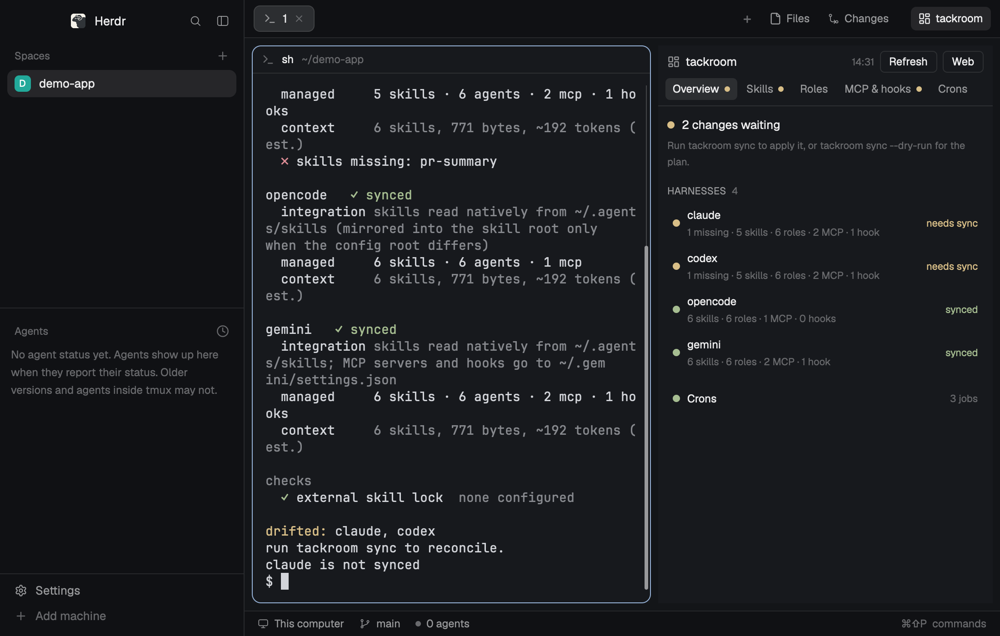

# tackroom

A side panel for [tackroom](https://github.com/yourconscience/tackroom), which keeps skills, MCP servers, hooks and roles in sync across Claude Code, Codex and other coding agents. It shows which agents are out of sync and why, every skill, role, MCP server and hook per agent, every machine in your setup, and every scheduled job, with Run now, Pause and Resume. It adds a tackroom button after Files and Changes and a panel in the right column; the rest of your layout stays as it is. Its tabs, Overview, Skills, Roles, MCP & hooks and Crons, match the web view's and draw the same tackroom commands.



## What you see

- **A tackroom button** at the right end of the tab bar, after Files and Changes: a 14px dashboard icon and "tackroom", 12px, in a 104px block that continues the tab bar's `chrome` background and bottom border. It reads `foreground` on `selected` while the tackroom panel shows, `muted` otherwise.
- **The tackroom panel** in the right column (368px, 280 to 900, hidden until opened), the third child of the `panel-body` stack after Files and Changes.
- **Header**, 36px: the tackroom icon, "tackroom", the time the open tab's data was loaded (or "loading…"), then two buttons: Refresh, which reloads the open tab's data at once, and Web, which opens the same tab of the running `tackroom view`.
- **Tab strip**: Overview, Skills, Roles, MCP & hooks and Crons, 12px, on `selected` for the open tab and `muted` for the rest. The strip wraps when the panel is too narrow for one line. A 6px dot after a label marks a tab that needs attention: `ansi1` for something failing, conflicting or unreadable, `ansi3` for something drifted, missing, held or out of sync. The dot shows from the first load, whichever tab is open.
- **Overview**: a headline ("All synced", "4 changes waiting" or "2 harnesses out of sync") and, when something is waiting, "Run tackroom sync to apply it, or tackroom sync --dry-run for the plan." With more than one host in `crons.hosts`, a "Machines" section comes next, one row per machine: its name, a health dot, the summary from `tackroom hosts` and, under it in `dim`, "Fix:" and the command, then the health in its tone (healthy, needs attention, failing). Then one row per harness: a state dot, its name, what it holds (what is missing or drifted first, then its skills, roles, MCP servers and hooks) and a state: synced, needs sync, a conflict count, config unreadable or not installed. A row opens into the exact names missing or drifted per surface, its conflicts and root file state. A "Held or blocked" list follows, one row per item sync skips: the item, why and "blocked" or "held"; it opens into when a hold ends and the exact command that overrides it. A line names sources a sync would fetch first. The last row is the Crons summary, and clicking it opens that tab.
- **Skills, Roles, MCP & hooks**: rows with a dot for the worst state among the harnesses, the name, a tag (a skill's origin, `local` or `owner/repo@commit`; a hook's event; "turned off" for a disabled server) and how many of the targeted harnesses have it in place (`2/3`). Rows that need attention come first, then the rest by name. A row opens into its description, origin and path (skills), command and targets (MCP servers and hooks), and its state in each harness in the web view's words: in place, drifted, missing, conflict, not targeted, turned off, not supported, not installed, config unreadable.
- **Crons**: an Add cron button, one line per host with a count per health (failing, last run failed, no result, healthy, paused; a host whose probe failed shows "unreachable" and the error), a "Needs attention" list, then one section per host, sorted by health. A job row opens into its command, effect, log, schedule, last result and problems, and its buttons (Run now, Pause or Resume, Edit, Delete). A job tackroom does not own shows "No edit or delete." and the reason in `dim`.
- **The dialog**, a 420px popup of this same mod (`props().form`): a title, then text inputs for the name (Add only), schedule, command, one input per argument with a remove button and "+ Add argument", and an optional effect, each under a label that carries an example and with no placeholder, because Herdr draws placeholders nearly as bright as typed text; Cancel and Add cron or Save. Delete shows the schedule and command and a red Delete button; Enter does not confirm it. An error from tackroom shows in `ansi1` above the buttons and the dialog stays open. Esc closes it.

## How it behaves

- The button shows the panel on the tab it last had (Overview when the app starts); clicking it again hides the panel, and Files or Changes switch the view, as their buttons do.
- The panel loads all four sources when it opens, then every `refresh` seconds (default 300, at least 60). Refresh reloads only the open tab's source; the button is dimmed while it loads.
- Clicking a row opens or closes its details; each tab keeps its own scroll position.
- A launchd job offers Run now and Pause, or Resume when it is disabled or unloaded, as in the web view. Other sources have no buttons. While an action runs its button reads "…" and every action button is dimmed. A notification says whether it worked; then the Crons tab loads again.
- Add opens the dialog empty; Edit opens it filled from `declared_schedule`, `declared_command` and `effect`, and sends only the flags that changed. On success the dialog closes, a notification says so and the Crons tab loads again; on failure it loads again too, because a failed apply leaves the config changed.
- Web opens the open tab of the running `tackroom view` (`#overview`, `#skills`, `#roles`, `#wiring` or `#crons`) in the default browser, signed in with the token it saved.
- Nothing on the other tabs writes. The panel has no Sync button: `sync --dry-run --json` lists what is missing and drifted but not every removal, setting or package change a sync makes, so the panel could not show the whole plan before applying it.
- Switching spaces restores that space's Files or Changes choice, as in Herdr's main layout; tackroom is not remembered per space.

## Built from

Two mods, `mods/tackroom/` and `mods/tackroom-toggle/`, both `place: "none"`. There is no layout file: the steps below add them to the layout you use.

### Add to your window

1. Read every file of both mods first, and tell the person what Watch out says about programs, SSH and files.
2. Copy `mods/tackroom/` and `mods/tackroom-toggle/` into Herdr's `mods/` folder (`~/.config/herdr-app/mods/`, or `$HERDR_APP_HOME/mods/`). If both are already there, this is an update: replace their files, skip to step 6, and leave the layout alone.
3. Find the shown layout (`herdr-app status` names it). If it already has blocks showing `tackroom` and `tackroom-toggle` (an earlier install, or the `tackroom` layout this repository used to ship), skip to step 6. If it is one of Herdr's own layouts, clone it and edit the clone: `herdr-app do layout.clone '{"name":"main","as":"main-tackroom"}'` makes it and switches to it. Change only the nodes below; keep every other node and property, and the person's other layouts, as they are.
4. Put the `tabs` block in a row with the tackroom button. The row takes the place and size of `tabs` (42px in main). `tabs` becomes its first child and keeps its properties, except that its size becomes `{ "weight": 1 }`:

   ```
   { "id": "tabs-row", "type": "row", "size": { "px": 42 }, "resizable": false,
     "children": [ <the tabs block, with "size": { "weight": 1 }>,
       { "id": "tackroom-toggle", "type": "block", "size": { "px": 104 }, "window_drag": true,
         "content": { "mod": "tackroom-toggle" } } ] }
   ```

5. Add the panel as the last child of the `panel-body` stack, after `files` and `changes`:

   ```json
   { "id": "tackroom", "type": "block", "content": { "mod": "tackroom", "props": { "refresh": 300 } } }
   ```

   The button finds the column `panel`, the stack `panel-body` and its child `tackroom` by id, so keep those ids. A layout without `panel` and `panel-body` (Terminals, Herdr 98) needs them beside its work area: `{ "id": "panel", "type": "column", "hidden": true, "size": { "px": 368 }, "min": 280, "max": 900, "children": [{ "id": "panel-body", "type": "stack", "active": "tackroom", "children": [<the tackroom block>] }] }`, with the button block in its top bar.
6. Run `herdr-app check` on both mod folders, make sure no `layouts/<name>.error` appeared, then click tackroom.

### The mods

- `mods/tackroom-toggle`: reads `layout()` for the `panel` column and `panel-body` stack and runs `layout.select {stack: "panel-body", child: "tackroom"}` with `layout.show {id: "panel"}`, or `layout.hide {id: "panel"}`. Its icon is `mods/tackroom/tackroom.svg`, so it needs the `tackroom` mod beside it.
- `mods/tackroom`: `main.js` the panel, `form.js` the dialog, `tackroom.svg` the icon (tinted). Props, all optional: `tackroom`, the program (default `tackroom` on the PATH Herdr runs programs with, for example `"~/.local/bin/tackroom"`); `config`, a config file other than tackroom's default (for example `"~/.agents/tackroom.yaml"`); `refresh`, seconds between loads.
- Data, each with `--config` when the prop is set:
  - Overview: `exec(tackroom, ["sync", "--dry-run", "--json"])`: `agents` (per harness, per surface: `managed`, `missing`, `drifted`; `conflicts`, `error`, `root_instructions`), `changes`, `synced`, `repo_link`, `held`, `not_fetched`. It writes and fetches nothing.
  - Overview's Machines: `exec(tackroom, ["hosts", "--json"])`: `hosts`, each with `host`, `health`, `summary` and `fix`, 5-minute timeout.
  - Skills, Roles, MCP & hooks: `exec(tackroom, ["config", "inventory"])`: `skills`, `roles`, `mcp`, `hooks` with a `states` map per harness, the document behind the web view's `/api/inventory`.
  - Crons: `exec(tackroom, ["cron", "collect"])`: `jobs` and `access`, 5-minute timeout. Health, short names and schedule words come from the JSON (`health`, `short_name`, `schedule_text`); tackroom works them out once for this panel and the web view.
- Actions: `exec(tackroom, ["cron", verb, "--config", config, "--host", host, "--source", source, id])` with `verb` run, pause or resume. Flags come before the id.
- Add, edit and delete: `exec(tackroom, ["cron", "add" | "edit" | "remove", "--config", config, id, ...flags])`; the id may sit anywhere among the flags. The dialog sends `run("tackroom.reload")` afterwards, which the panel receives from `nextCommand()` and answers with a Crons load.
- Web: `exec("/bin/sh", ...)` reads `view.addr` and `view.token` from `${XDG_STATE_HOME:-~/.local/state}/tackroom` and runs `open` with the URL.
- `herdr` functions: `exec`, `props`, `theme`, `layout`, `notify`, `openOverlay`, `closeOverlay`, `run`, `nextCommand`; commands `layout.select`, `layout.show`, `layout.hide`. Text input: `InputState` and `Input` from `gpui-base`, `openOverlay` with `kind: "dialog"`. Every colour is a theme slot; none is fixed in the mods.
- Shipped mods it sits beside: `tabs`, `files` and `changes`.

## Watch out

- **It runs programs and reads files outside its folder.** It runs `tackroom` (or the `tackroom` prop) for every load and action, and `/bin/sh` to find `$HOME` and to open the web view with `open`. It reads `view.addr` and `view.token` from tackroom's state folder (`${XDG_STATE_HOME:-~/.local/state}/tackroom`). Through tackroom, Crons and Machines reach every host in `crons.hosts` over SSH; the Crons buttons run, pause and resume launchd jobs, and Add, Edit and Delete change `tackroom.yaml` and the job's unit. The other tabs only read.
- **Needs tackroom 2.4 or newer** (`tackroom --version`) on the PATH Herdr runs programs with, or the `tackroom` prop set to its path. With 2.3 the Machines section stays away; older releases lack `config inventory` and those tabs show the error.
- `exec` does not expand `~`; the mod expands a leading `~/` in its props itself from `$HOME`.
- Herdr's `tabs` mod draws only the Files and Changes buttons and remembers only those per space; that is why tackroom is a separate block, and why a space switch can close the tackroom panel.
- Renaming the `tackroom` mod (a name clash) means changing `mods/tackroom/` in both `main.js` files, `mod: "tackroom"` in `openOverlay` and `run("tackroom.reload")` in `form.js`. A copy under another name still loads on its timer and the Refresh button.
- On Windows, the tab bar ends with the window buttons, so the tackroom block lands right of them. Run now, Pause and Resume work on launchd jobs only, and Web runs macOS `open`, so it works on macOS only.
- Web reads tackroom's default state folder, so it does not find a view started with another `--token-file`.
- A crons collect probes every host over SSH; on a loaded machine the local probe can hit tackroom's 2-minute timeout and the host shows unreachable until the next collect. The other sources are local and quick.
- The Skills tab lists what the web view lists, including skills of a source sync has not pinned because it is blocked or held: they show as missing in every harness, while Overview lists the source under "Held or blocked" and counts the harnesses as synced.
- A disabled or untargeted MCP server or hook shows in its tab with the state "turned off" or "not targeted"; the Overview counts only what is in place.
- An owned job shows its declared schedule (`declared_schedule`), not the entries launchd expanded it into. Collected from a host that does not declare it, the expansion still reads as one schedule: sixteen `0 8 N * *` entries for odd days are "Every 2 days 08:00", `0 * * * *; 30 * * * *` is "Every 30 min".
- A change to a job shows when the full collect that follows finishes, not at once as in the web view.
- `herdr-app check` renders only the first frame, with no data. To check the tabs, check copies of the mod that start with each tab open and the data of the four commands in place, with a few rows open, plus one that forces `form: { mode: "add" }`, `edit` (with a `job`) and `delete` for the dialog.

## Done when

- `herdr-app check ~/.config/herdr-app/mods/tackroom` and `herdr-app check ~/.config/herdr-app/mods/tackroom-toggle` pass, and no `layouts/<name>.error` appears.
- The layout shows a tackroom button after Files and Changes. Clicking it opens the panel on Overview with the five tabs; clicking it again hides the panel. The rest of the window is as it was.
- Overview lists the same harnesses, counts and held items as `tackroom sync --dry-run`, and the same machines, summaries and fixes as `tackroom hosts`; Skills, Roles and MCP & hooks list the same rows and states as the web view's tabs; Crons lists the same jobs, per host, with the same health counts as the web Crons tab.
- Run now on a launchd job raises its run count after the next collect; Pause turns its row grey with "paused" and offers Resume; Resume brings it back.
- Add creates a job that shows in the panel and in `tackroom view`; Edit changes it; Delete asks, then removes it, its YAML entry and its unit. A job tackroom does not own shows the reason and no Edit or Delete.
