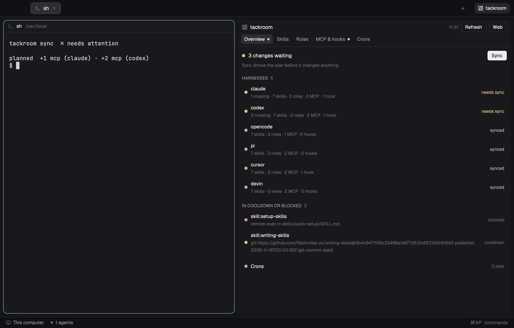

# tackroom

A side panel for [tackroom](https://github.com/yourconscience/tackroom), which keeps skills, MCP servers, hooks and roles in sync across Claude Code, Codex and other coding agents. Its Overview answers first, in one line, whether anything needs you, counting harnesses, machines and crons together, and lists only what fails or needs attention, each with its fix or its actions. It shows which agents are out of sync and why, and which outside skills are pinned, in cooldown or blocked by the audit, every skill, role, MCP server and hook per agent, every machine in your setup, and every scheduled job, and changes what tackroom's web view changes: Sync, after showing the plan; Turn on and off for harnesses, MCP servers and hooks; which agents an MCP server or hook targets; and Run now, Pause, Resume, Log, Add, Edit and Delete for crons. It adds a tackroom button after Files and Changes and a panel in the right column; the rest of your layout stays as it is. Its tabs, Overview, Skills, Roles, MCP & hooks and Crons, match the web view's and draw the same tackroom commands.



## What you see

- **A tackroom button** at the right end of the tab bar, after Files and Changes: a 14px tackroom logo mark and "tackroom", 12px, in a 104px block that continues the tab bar's `chrome` background and bottom border. It reads `foreground` on `selected` while the tackroom panel shows, `muted` otherwise.
- **The tackroom panel** in the right column (368px, 280 to 900, hidden until opened), the third child of the `panel-body` stack after Files and Changes.
- **Header**, 40px: the tackroom icon, "tackroom", a pill, then at the right the local tackroom version in `muted` and two quiet `muted` buttons: Refresh, which reloads the open tab's sources at once, and Web, which opens the same tab of `tackroom view`, starting the view when none runs. Nothing in the line is cut. The pill is `muted` on `raised`, 11px, fully rounded: left out below 340px of panel width; from 340px it holds the short hash of the config commit ("9b13be6"); from 440px it holds "~/.agents · 9b13be6", with the path cut at its start only while at least 8 characters of it stay, else the hash alone. The version never gives way: it is left out only when even without a pill it would not fit. The widths are worked out for a monospace UI font, about 0.6em a character. The path is the local host's `config_root` from `tackroom hosts --json` (else the sync plan's), the hash the document's `commit` and the version its `version`.
- **Tab strip**: Overview, Skills, Roles, MCP & hooks and Crons, 12px: the open tab in `foreground` over a 2px `accent` underline, the rest `muted`, above a 1px `border` rule. The strip wraps when the panel is too narrow for one line: a wrapped line follows the one above by 2px, and each underline sits 4px under its own label. A count after a label marks a tab that needs attention: how many things fail, in `ansi1`, else how many need attention, in `ansi3`. It shows from the first load, whichever tab is open, and counts the same things the tab lists.
- **Footer**, 36px under the scrolling part of every tab, above a 1px `border` rule: at the left the config root of This Mac and its state, "~/.agents · 1 uncommitted" in `ansi3` or "~/.agents · clean" in `muted` (the local host's `config_root` and `dirty`; with no git commit there, the path alone); at the right "loaded 10:22", the time the open tab's oldest data was loaded, or "loading…". A path of 16 characters or fewer is never cut; a longer one is cut at its start. When the row is tight, "loaded" goes and only the time stays; when that is still too wide, the time moves to a second line under the path and the footer grows to two lines. Only the part between the tab strip and the footer scrolls.
- **Colours and actions**: one accent (`accent`) for the open tab, three status colours (`ansi1` failing, `ansi3` needs attention, `ansi2` healthy), `dim` for what is off or secondary, and `foreground`, `muted`, `border`, `hover`, `raised`, `surface` and `background` for the rest. A status dot shows only where something fails or needs attention, except at the answer, in the Overview's harness grid and on its "Everything else" lines. Actions are quiet buttons: 12px `foreground` text in a 1px `border` outline, radius 8, padding 3px 9px, a `hover` fill under the pointer, dimmed while they cannot act; a row of them wraps when it does not fit. The one filled button is Sync beside the Overview's answer. Section titles are 13px, semibold and sentence case, with their count ("Needs attention · 2"): `ansi1` for Failing, `ansi3` for Needs attention, `muted` for the rest. A mod cannot set letter spacing, so the titles are not spaced out.
- **Overview**: the answer first, a 12px status dot and a 20px line counted from every source: "2 failing, 2 need attention", "1 needs attention", "All clear", or "Checking…" while the plan, inventory, crons or machines have not loaded yet and nothing is wrong so far. It never reads "All clear" while something under it fails or needs attention, or while any of the four sources has not loaded once or failed to. Under it, in `muted`: "All 7 installed harnesses are in sync." when they are, what the failures are when they are all one kind ("Both failures are crons."), and "Still checking the inventory and machines." for what has not loaded. At its right sits Sync, the one filled button (`accent` fill, `accent_foreground` text, radius 8, 12px semibold), only while a sync waits and tackroom can apply it; it opens the sync dialog. Then, top to bottom, each only when it has something to show:
  - **Counts**: one `surface` card (1px `border`, radius 12) of equal cells: Skills, Roles, MCP, Hooks and Crons, each a 15px semibold number over an 11px `muted` label. A number is `ansi1` or `ansi3` when something of that kind fails or needs attention, "…" in `muted` while its source loads and "–" in `dim` when it did not load. A kind with none is left out. A cell opens its tab; MCP and Hooks both open MCP & hooks.
  - **Harnesses**: the column labels SK, RO, MCP and HK (10px, `dim`, 22px columns), then one row per installed harness: a 16px icon, its name and four 22px cells, one per surface. A cell is a dot, `ansi2` where everything of that surface is in place, `ansi3` where something is missing or drifted or a sync would remove something, `ansi1` where there is a conflict or the config cannot be read (the sync plan says a harness has a conflict and the inventory says on which surface, so no cell is red or yellow for a harness the answer counts as in sync); or a `dim` dash where the harness does not take the surface (the inventory's `supports_roles`, `supports_mcp` and `supports_hooks`; every harness takes skills). Until the inventory has loaded, or when it failed, support is not known and those three cells are a `dim` middle dot ("·"), not a dot. A cell shows the worst thing on its surface; there is no half state. A harness that is not in sync also shows it in the colour of its name, since some changes belong to no surface. The icon is Herdr's own for the program of that name, found among the agents running now and those Herdr can start (`knownAgents()`), else a rounded square on `raised` with the first letters of up to two words of its name in 9px ("QC" for Qwen Code). Failing harnesses come first, then those that need attention, then the rest in the plan's order. Past six rows the ones in sync fold into one line, "+N more in sync", which opens them. A row opens into its counts (missing, drifted, skills, roles, MCP, hooks) and, with edits, Turn off. When everything is synced but a sync would first fetch sources, a `dim` line under the grid says so.
  - **Failing** (`ansi1` title and count): a failing cron; a harness with a conflict or an unreadable config; a failing machine of `tackroom hosts` (unreachable, not set up, a major version behind); a host the crons collect could not reach.
  - **Needs attention** (`ansi3` title and count): a cron whose last run failed; the sync waiting ("4 changes waiting to sync", the harnesses that need it and how many items are missing or drifted, the config root link when it is not synced, the sources a sync would fetch first) with a Sync action; each machine that needs attention; a source the audit blocked, with its override command; a source that did not load (the plan, the inventory, the crons or the machines), with its error and Retry. A refresh that fails while data is shown keeps the data and the answer.
  - Each row: its name in 13px semibold and where it is in `muted` on the right ("This Mac · Sun 06:00"); why, one sentence in `muted` with, at its right, when a cron last ran; a path the problem names on its own `dim` line, cut at the start; commands in `dim` (a blocked source's "Override: tackroom doctor audit accept …"); then its actions, on a line of their own: a cron row's are Run now and Pause, or Resume, Log and Details (Hide while open), which fit on one line at 280px. Details opens the rest: a cron's fields with Edit and Delete, a harness's conflicts and missing or drifted items with Turn off, the harnesses that need the sync, each opening into its details. A machine is a row of its own with no actions: a status dot (`ansi1` or `ansi3`), its name in 13px semibold, its summary as one wrapping `muted` line ("Out of sync: ouroboros. Runs tackroom 3.0.2, this machine 3.1.0.") and its fix on a `dim` line ("Fix: ssh m4 tackroom sync", or `git -C ~/.agents status` for uncommitted changes).
  - **Outside skills** (10px `dim` title): a wrapping row of chips (1px `border`, fully rounded, 12px): "3 pinned" in `muted`; one `ansi3` chip per pinned source with audit findings ("taste-skill · 1 finding"); "1 in cooldown" in `muted` and "1 blocked" in `ansi1`, each only when there is one. A chip opens the Skills tab. The section is left out when there are no outside sources.
  - **Everything else**, under a 1px rule: what is healthy or off, folded to one line per kind, each a dot, a 13px line and `muted` lines under it: "12 crons healthy" with how many are paused or not run yet, which opens the Crons tab; "Both machines on config 604ca00" with the tackroom version on each, with more than one host in `crons.hosts`, which opens into one row per machine (name, summary, Fix, health); "1 in cooldown" with each source as `owner/repo@<7 hex>` (the package and version for npm and PyPI) and the time left, such as `37h left of 72h`, from `until`, or tackroom's own reason text when `until` is missing, which opens into when each cooldown ends and the exact command that overrides it; and harnesses not installed and turned off in the config on one line ("4 not installed, 1 turned off" and their names), which opens into one row each with Turn off or Turn on.
- **Skills, Roles, MCP & hooks**: the answer first, as on Overview: "32 skills, in place everywhere" (with how many are yours and how many come from outside sources), "6 roles, in place in all 5 harnesses that take roles" (with the harnesses that do not), "2 MCP servers and 2 hooks, all in place" (or how many are turned off), or "2 skills need attention". The line under it names what needs attention first, up to three rows and where each is wrong ("builder is missing in Claude Code and Pi. general has drifted in OMP."), then the count of the rest. Then a "Needs attention" group with those rows, then the rest by name under the tab's group titles (Skills; Roles; MCP servers and Hooks), each with its count and an "in place" column label. On Skills, an outside source the audit blocked needs attention, as on Overview: its skills join the group whatever their states, tagged "source blocked", under a card for the source with the audit's reason and the override command; the answer names it ("brag comes from latent-spaces/brag, which the audit blocked."), and a blocked source no skill comes from counts too ("1 skill and 1 outside source need attention"). A skill of a source in cooldown stays with the rest, tagged "in cooldown", since sync takes it when the cooldown ends. A row: an 8px dot only when the worst state among the harnesses fails or needs attention, the name, a `dim` tag (an outside skill's `repo@commit`; a hook's event; "turned off" for a disabled entry) and, right-aligned in one column, how many of the targeted harnesses have it in place (`2/3`). A row opens into its description, origin and path (skills), command and targets (MCP servers and hooks), and its state in each harness in the web view's words: in place, drifted, missing, conflict, not targeted, turned off, not supported, not installed, config unreadable; only a state that fails or needs attention takes its status colour. For an MCP server or hook, each harness line ends with Remove (targeted) or Add (not targeted) in one right-hand column, except where it is not supported, not installed or unreadable, and the open row ends with Turn off or Turn on.
- **Crons**: the answer first, "2 of 18 jobs failing" or "18 jobs, none failing" (with any host whose probe failed, "vps unreachable"), the hosts and what every job that is not failing is ("On This Mac and m4: 1 last run failed, 12 healthy, 2 paused, 1 not run yet.", with no "last run failed" count when none is), and Add cron at its right. Then "Failing" (unreachable hosts and failing jobs) and "Needs attention" (jobs whose last run failed), as rows of the Overview with the same actions. Then, under a 1px rule, the rest folded per machine: the host's name with its counts ("8 healthy, 1 not run yet"), then one 22px line per job, healthy first, then paused and not run yet, by name: the name, its schedule in a 112px column ("Paused" for a paused job) and its last run right-aligned on one line in an 80px column ("not run" for one never run); paused and not-run jobs in `dim`. A line opens into its health, host, ID, command, effect, log, schedule, last run, result and problems, and its actions (Run now, Pause or Resume, Log, Edit, Delete). A job tackroom does not own shows "No edit or delete." and the reason in `dim`.
- **The dialog**, a 420px popup of this same mod (`props().form`): a title, then text inputs for the name (Add only), schedule, command, one input per argument with a remove button and "+ Add argument", and an optional effect, each under a label that carries an example and with no placeholder, because Herdr draws placeholders nearly as bright as typed text; Cancel and Add cron or Save. Delete shows the schedule and command and a red Delete button; Enter does not confirm it. Sync lists each change of the plan once, 12.5px, with the harnesses it touches under it in `dim`, then "REMOVES OR OVERWRITES" and those items in `ansi1`, then a `dim` line: "Sync applies this plan from the config it was made from. If the plan or the config changed since it loaded, it stops and the panel loads the new plan. Edits inside skill and role files are not checked." Its button is Sync, or a red Sync and remove when the plan removes or overwrites something; Enter does not confirm it. An error from tackroom shows in `ansi1` above the buttons and the dialog stays open. After a failed sync a `dim` line follows the error, "Nothing more is applied from this plan. Cancel, then press Sync for the current one.", and the Sync button is dimmed and does nothing. Esc closes it.

## How it behaves

- The button shows the panel on the tab it last had (Overview when the app starts); clicking it again hides the panel, and Files or Changes switch the view, as their buttons do.
- The panel loads all four sources 300ms after it opens, then every `refresh` seconds (default 300, at least 60). Refresh reloads the open tab's sources that are not loading already: all four on Overview, which draws from all of them, the inventory on Skills, Roles and MCP & hooks, the collect on Crons. The button is dimmed while every one of them loads. Overview draws what has loaded so far and says what it is still checking.
- Clicking a row opens or closes its details; each tab keeps its own scroll position.
- A launchd job offers Run now and Pause, or Resume when it is disabled or unloaded, as in the web view. Other sources have no run actions. While an action runs its label reads "…" and every action is dimmed. A notification says whether it worked; then the Crons tab loads again.
- Log, on a job whose log is a file, opens a terminal tab named "<job> log" that follows it: `tail -n 200 -F -- <log>` on this Mac, `ssh -t -- <host> "tail -n 200 -F -- '<log>'"` for a job on another host. Ctrl-C ends it. A systemd `file:` or `append:` prefix is dropped; a leading `~/` is expanded from `$HOME` on this Mac and left outside the quotes for the remote shell. A job that logs to the journal, inherits its output or names no file has no Log.
- Add opens the dialog empty; Edit opens it filled from `declared_schedule`, `declared_command` and `effect`, and sends only the flags that changed. On success the dialog closes, a notification says so and the Crons tab loads again; on failure it loads again too, because a failed apply leaves the config changed.
- Web opens the open tab of `tackroom view` (`#overview`, `#skills`, `#roles`, `#wiring` or `#crons`) in the default browser, signed in. With no view running, tackroom starts one in the background first. With a tackroom that lacks `view --json` (2.8 and older), Web opens a running view from `view.addr` and `view.token` as it did before and needs one running. A failure shows as a notification with tackroom's last line.
- Sync opens the dialog with the plan from the Overview's last load. On success the dialog closes, a notification says "Synced" and Overview, the inventory tabs and Machines load again; on failure the error shows in the dialog and they load again too, and the dialog leaves only Cancel: its plan is no longer the current one, so Sync on Overview opens the new plan.
- Turn on, Turn off, Add and Remove change one field at once and notify "<name> turned off" (or added to, removed from), "Saved. Sync applies it."; then Overview and the inventory tabs load again, so the change shows as waiting. Removing the last targeted harness is refused with a notification: turn the entry off instead. While one runs, every action is dimmed.
- Sync and the on, off, Add and Remove buttons show only when `sync --dry-run --json` has `plan_digest`, which comes with `config set`; with an older tackroom the panel says "Update tackroom to sync and edit from this panel." and only the Crons tab acts.
- Switching spaces restores that space's Files or Changes choice, as in Herdr's main layout; tackroom is not remembered per space.

## Built from

Two mods, `mods/tackroom/` and `mods/tackroom-toggle/`, both `place: "none"`. There is no layout file: the steps below add them to the layout you use.

### Add to your window

1. Read every file of both mods first, and tell the person what Watch out says about programs, SSH and files.
2. Copy `mods/tackroom/` and `mods/tackroom-toggle/` into Herdr's `mods/` folder (`~/.config/herdr-app/mods/`, or `$HERDR_APP_HOME/mods/`). If both are already there, this is an update: replace their files, skip to step 6, and leave the layout alone.
3. Find the shown layout (`herdr-app status` names it). If it already has blocks showing `tackroom` and `tackroom-toggle` (an earlier install, or the `tackroom` layout this repository used to ship), skip to step 6. If it is one of Herdr's own layouts, clone it and edit the clone: `herdr-app do layout.clone '{"name":"main","as":"main-tackroom"}'` makes it and switches to it. Change only the nodes below; keep every other node and property, and the person's other layouts, as they are.
4. Put the `tabs` block in a row with the tackroom button. The row takes the place and size of `tabs` (42px in main). `tabs` becomes its first child and keeps its properties, except that its size becomes `{ "weight": 1 }`:

   ```
   { "id": "tabs-row", "type": "row", "size": { "px": 42 }, "resizable": false,
     "children": [ <the tabs block, with "size": { "weight": 1 }>,
       { "id": "tackroom-toggle", "type": "block", "size": { "px": 104 }, "window_drag": true,
         "content": { "mod": "tackroom-toggle" } } ] }
   ```

5. Add the panel as the last child of the `panel-body` stack, after `files` and `changes`:

   ```json
   { "id": "tackroom", "type": "block", "content": { "mod": "tackroom", "props": { "refresh": 300 } } }
   ```

   The button finds the column `panel`, the stack `panel-body` and its child `tackroom` by id, so keep those ids. A layout without `panel` and `panel-body` (Terminals, Herdr 98) needs them beside its work area: `{ "id": "panel", "type": "column", "hidden": true, "size": { "px": 368 }, "min": 280, "max": 900, "children": [{ "id": "panel-body", "type": "stack", "active": "tackroom", "children": [<the tackroom block>] }] }`, with the button block in its top bar.
6. Run `herdr-app check` on both mod folders, make sure no `layouts/<name>.error` appeared, then click tackroom.

### The mods

- `mods/tackroom-toggle`: reads `layout()` for the `panel` column and `panel-body` stack and runs `layout.select {stack: "panel-body", child: "tackroom"}` with `layout.show {id: "panel"}`, or `layout.hide {id: "panel"}`. Its icon is `mods/tackroom/tackroom.svg`, so it needs the `tackroom` mod beside it.
- `mods/tackroom`: `main.js` the panel, `form.js` the dialog, `tackroom.svg` the icon, the mono logo mark from `docs/brand/logo-a-mono.svg` (tinted). Props, all optional: `tackroom`, the program (default `tackroom` on the PATH Herdr runs programs with, for example `"~/.local/bin/tackroom"`); `config`, a config file other than tackroom's default (for example `"~/.agents/tackroom.yaml"`); `refresh`, seconds between loads.
- Data, each with `--config` when the prop is set. Overview draws from all four: the plan, the machines and the crons for its answer and rows, the inventory for harness names, the turned-off harnesses, the counts and the pinned sources.
  - Overview: `exec(tackroom, ["sync", "--dry-run", "--json"])`: `agents` (per harness, per surface: `managed`, `missing`, `drifted`; `conflicts`, `error`, `root_instructions`), `changes`, `synced`, `repo_link`, `skipped` (`held` from a tackroom older than 3.0), `not_fetched`. It writes and fetches nothing.
  - Overview's Machines: `exec(tackroom, ["hosts", "--json"])`: `hosts`, each with `host`, `health`, `summary` and `fix`, 5-minute timeout. The header's pill, the version and the footer read `version` and `commit` of the document and the `host: "local"` entry's `config_root`, `commit` and `dirty`.
  - Skills, Roles, MCP & hooks: `exec(tackroom, ["config", "inventory"])`: `skills`, `roles`, `mcp`, `hooks` with a `states` map per harness, `agents`, `home` and `lock` (the outside sources; Overview shows no chips for them when `lock` is missing), the document behind the web view's `/api/inventory`.
  - Crons: `exec(tackroom, ["cron", "collect"])`: `jobs` and `access`, 5-minute timeout. Health, short names and schedule words come from the JSON (`health`, `short_name`, `schedule_text`); tackroom works them out once for this panel and the web view.
- Actions: `exec(tackroom, ["cron", verb, "--config", config, "--host", host, "--source", source, id])` with `verb` run, pause or resume. Flags come before the id.
- Log: `run("terminal.open", { argv, name: "<job> log", place: "tab" })` with `argv` `["tail", "-n", "200", "-F", "--", log]`, or `["ssh", "-t", "--", host, "tail -n 200 -F -- '<log>'"]` for another host (`~/'<rest>'` for a log under the remote home). The `--` keeps a host or path that starts with `-` from reading as an option.
- Edits: `exec(tackroom, ["config", "set", "--config", config, path, JSON.stringify(value)])`, with `path` `agents/<name>/enabled`, `mcp_servers/<name>/enabled`, `hooks/<name>/enabled` or `<mcp_servers|hooks>/<name>/agents`. A new `agents` list starts from the entry's `targets` when it is `explicit`, otherwise from every harness with `supports_mcp` or `supports_hooks`, and keeps the order of the inventory's `agents`.
- Sync: `exec(tackroom, ["sync", "--plan-digest=" + plan_digest, "--config", config])`, 5-minute timeout. The digest is joined to its flag with `=` because `--config` is inserted after the first two arguments. The dialog then sends `run("tackroom.synced")`, which the panel answers by loading Overview, the inventory and Machines.
- Add, edit and delete: `exec(tackroom, ["cron", "add" | "edit" | "remove", "--config", config, id, ...flags])`; the id may sit anywhere among the flags. The dialog sends `run("tackroom.reload")` afterwards, which the panel receives from `nextCommand()` and answers with a Crons load.
- Web: `exec(tackroom, ["view", "--json", "--config", config])`, 30-second timeout, then `exec("/usr/bin/open", [url + "#" + tab])` with `url` from the JSON. When tackroom answers "flag provided but not defined", Web falls back to `exec("/bin/sh", ...)`, which reads `view.addr` and `view.token` from `${XDG_STATE_HOME:-~/.local/state}/tackroom` and runs `open` with the URL.
- `herdr` functions: `exec`, `props`, `theme`, `settings`, `home`, `agents`, `knownAgents`, `layout`, `notify`, `openOverlay`, `closeOverlay`, `run`, `nextCommand`; commands `layout.select`, `layout.show`, `layout.hide`, `terminal.open`. Text input: `InputState` and `Input` from `gpui-base`, `openOverlay` with `kind: "dialog"`. Every colour is a theme slot; none is fixed in the mods.
- Shipped mods it sits beside: `tabs`, `files` and `changes`.

## Watch out

- **It runs programs and reads files outside its folder.** It runs `tackroom` (or the `tackroom` prop) for every load and action, `/bin/sh` to find `$HOME` and `/usr/bin/open` to open the web view. Log opens a terminal tab running `tail`, or `ssh <host> tail` for a job on another machine of `crons.hosts`. Web runs `tackroom view --json`, which starts a background view when none runs; that view exits on its own when idle. With an older tackroom, Web reads `view.addr` and `view.token` from tackroom's state folder instead. Through tackroom, Crons and Machines reach every host in `crons.hosts` over SSH; the Crons buttons run, pause and resume launchd jobs, and Add, Edit and Delete change `tackroom.yaml` and the job's unit. The other tabs only read. The Overview's harness icons come from `knownAgents()`, which has Herdr look for the agents' programs in the person's shell, once, 300ms after the panel opens.
- **Start the first loads from a timer, not from `init`.** On Herdr 0.1.15 an `exec` started in `init` of a panel created hidden or covered (as the panel is at app start) never returned, and every later load waited behind it, so the panel showed "Loading…" for good.
- **Needs tackroom 2.4 or newer** (`tackroom --version`) on the PATH Herdr runs programs with, or the `tackroom` prop set to its path. With 2.3 the machines stay off the Overview; older releases lack `config inventory` and those tabs show the error. Web starts the view only with a tackroom that has `view --json`, tackroom 3.0 or newer; with 2.8 or older it opens a view that is already running.
- `exec` does not expand `~`; the mod expands a leading `~/` in its props itself from `$HOME`.
- A harness icon is found by matching the harness id or display name with the `key` or `name` of Herdr's program entries; a harness with no match, or one whose program has no icon, shows a letter. The header's pill shows from a panel width of 340px, read from `on_size_change` and divided by Herdr's `zoom` setting.
- Herdr's `tabs` mod draws only the Files and Changes buttons and remembers only those per space; that is why tackroom is a separate block, and why a space switch can close the tackroom panel.
- Renaming the `tackroom` mod (a name clash) means changing `mods/tackroom/` in both `main.js` files, `mod: "tackroom"` in `openOverlay` and `run("tackroom.reload")` and `run("tackroom.synced")` in `form.js`. A copy under another name still loads on its timer and the Refresh button.
- On Windows, the tab bar ends with the window buttons, so the tackroom block lands right of them. Run now, Pause and Resume work on launchd jobs only, and Web runs macOS `open`, so it works on macOS only.
- Web reads tackroom's default state folder, so it does not find a view started with another `--token-file`.
- A crons collect probes every host over SSH; on a loaded machine the local probe can hit tackroom's 2-minute timeout and the host shows unreachable until the next collect. The other sources are local and quick.
- The Skills tab lists what the web view lists, including skills of a source sync has not pinned because it is blocked or in cooldown: they show as missing in every harness. A blocked source's skills count as needing attention, as the source does on Overview; a cooldown source's skills stay with the rest, as the cooldown does in Overview's "Everything else", and the harnesses count as synced.
- A disabled or untargeted MCP server or hook shows in its tab with the state "turned off" or "not targeted"; the Overview counts only what is in place.
- An owned job shows its declared schedule (`declared_schedule`), not the entries launchd expanded it into. Collected from a host that does not declare it, the expansion still reads as one schedule: sixteen `0 8 N * *` entries for odd days are "Every 2 days 08:00", `0 * * * *; 30 * * * *` is "Every 30 min".
- A change to a job shows when the full collect that follows finishes, not at once as in the web view.
- `herdr-app check` renders only the first frame, with no data. To check the tabs, check copies of the mod that start with each tab open and the data of the four commands in place, with a few rows open, plus one that forces `form: { mode: "add" }`, `edit` (with a `job`) and `delete` for the dialog.

## Done when

- `herdr-app check ~/.config/herdr-app/mods/tackroom` and `herdr-app check ~/.config/herdr-app/mods/tackroom-toggle` pass, and no `layouts/<name>.error` appears.
- The layout shows a tackroom button after Files and Changes. Clicking it opens the panel on Overview with the five tabs; clicking it again hides the panel. The rest of the window is as it was.
- Overview's answer counts the rows under it, and lists the same harnesses, counts and items in cooldown or blocked as `tackroom sync --dry-run`, the same machines, summaries and fixes as `tackroom hosts`, and the same failing crons as the Crons tab; it reads "All clear" only when all four sources have loaded and none of them has anything failing or needing attention; Skills, Roles and MCP & hooks list the same rows and states as the web view's tabs; Crons lists the same jobs, per host, with the same health counts as the web Crons tab.
- Run now on a launchd job raises its run count after the next collect; Pause turns its line `dim` with "Paused" and offers Resume; Resume brings it back. Log opens a tab that follows the job's log, on this Mac or over ssh.
- Add creates a job that shows in the panel and in `tackroom view`; Edit changes it; Delete asks, then removes it, its YAML entry and its unit. A job tackroom does not own shows the reason and no Edit or Delete.
- Turn off on an MCP server writes `enabled: false` where `tackroom config print` shows it, and Overview then shows changes waiting; Sync shows the plan with the server's removals in red, and after Sync and remove `tackroom sync --dry-run` reports nothing to do. Add on a harness line of an MCP server or hook adds that harness to its `agents`. Turn off on a hook, or Remove on one of its harness lines, makes the plan read "remove hook <name>" for each harness that has it registered, in red, and Sync and remove takes the command out of that harness's hook file.
- A tackroom without `config set` (2.5.1 or older) shows no Sync, Turn on, Turn off, Add or Remove.
